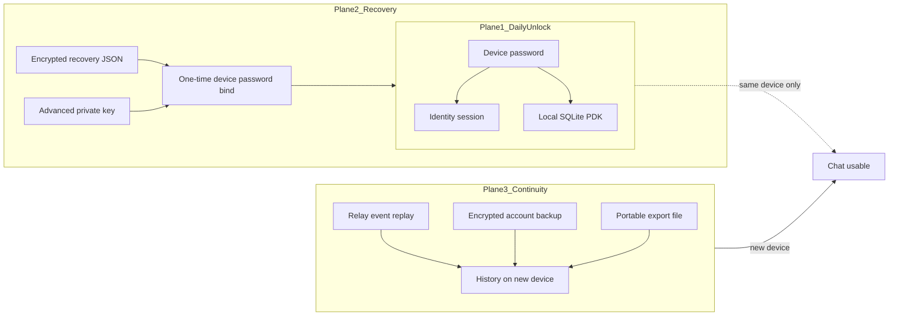

# Deliberation — Auth unlock & cross-device continuity (multi-audience)

**Date:** 2026-11-01  
**Status:** Deliberation — awaiting maintainer accept  
**Parents:** [single-door-unlock-design-2026-11.md](./single-door-unlock-design-2026-11.md) · [auth-wallet-unlock-design-2026-11.md](./auth-wallet-unlock-design-2026-11.md) · [obscur-auth-kernel-charter-2026-06.md](../../docs/program/obscur-auth-kernel-charter-2026-06.md) · [obscur-ecosystem-charter.md](../../docs/program/obscur-ecosystem-charter.md)  
**Sibling (Plane 3 north star):** [continuity-pioneering-design-2026-11.md](./continuity-pioneering-design-2026-11.md) — living-graph reconstitution + SCU residue + fungible carriers (file / relay / pair / DTN); not “pick export vs cloud” as two architectures  
**As-built:** [03-account-sync-backup-restore.md](../../docs/exploration/modules/03-account-sync-backup-restore.md) · [as-built-architecture-and-fork-options.md](../../docs/exploration/synthesis/as-built-architecture-and-fork-options.md)

```text
HANDOFF ATOMIC STEP: AUTH CONTINUITY DELIBERATION — three planes + audience stance (specs only)
PAUSED / CANCELLED: Soft L3 · Tor Verified · Spaces · Matrix promote · OAuth root · BKP-2 impl · PDK-from-nsec
CANONICAL OWNER:     specs/backend (product contract) · AuthScreen (Planes 1–2) · account-sync (Plane 3)
PROOF BEFORE DONE:   Spec landed · single-door sibling note · handoff NEXT retargeted (no unlock code this band)
```

## Problem

Prior unlock work refined UI without removing the **hex + password** double door. That double door is a Plane 1–2 failure. Separately, users (and agents) conflate unlock with **cross-device history**, which is Plane 3 and is incomplete on native today (backup publish reads chat-state, not SQLite bodies). Treating both as one “auth” problem produces polish that never feels convenient.

## Binding constraints (already decided)

| Constraint | Rule |
|------------|------|
| Identity root | Local keypair (self-custody). No OAuth / email / SMS as root. |
| Daily face | Device passphrase. Hex/`nsec` = Advanced recovery only. |
| Biometric MFA | Forbidden as product requirement. |
| Enterprise IdP | Later only as optional attestation / SSO **bridge**, never sole root. |
| Continuity as-built | Native DM/group bodies in SQLite; encrypted backup publish still chat-state-only → restore sparse. |
| Soft L3 / Tor / Spaces | PAUSED — do not load continuity promises onto those tracks. |

Charter primary faces: private groups + high-requirement communicators. Enterprise SSO procurement and “crypto traders needing chain-native chat” are **not** primary personas — they still pressure UX and get honest answers below.

---

## Three planes (not one “login”)

Users collapse three jobs into “sign in.” Obscur must name them or every audience feels lied to.



| Plane | Job | User-facing secret | What it does **not** do |
|-------|-----|--------------------|-------------------------|
| **1 · Daily unlock** | Open *this* computer’s locked profile | Device password only | Move history to another machine |
| **2 · Recovery** | Rebind identity after wipe / new install | Recovery file + password, **or** Advanced key → then set device password once | Replace cloud “forgot password” |
| **3 · Continuity** | Reconstitute conversations / settings across devices | Same password (unwraps backup) + relay access | Happen automatically from Plane 1 alone |

**Single-door verdict:** [single-door-unlock-design-2026-11.md](./single-door-unlock-design-2026-11.md) correctly collapses Planes 1–2. It does **not** solve Plane 3. Slice A+B+C remain **Plane 1–2 only**. Continuity honesty UI is a sibling band — not mixed into Auth unlock diffs.

---

## Audience lenses

### 1. Non-technical users (friends / small private groups — charter P5)

| | |
|--|--|
| **Mental model** | Password = account. Lost password → reset email. New phone → everything appears. |
| **Pain today** | Hex + password feels like bank setup; soft-lock after key feels broken; no “forgot password.” |
| **Honest promise** | Daily: one password → chat on *this* device. Create: password + save recovery file. New device: recovery file **or** key once → set *this computer’s* password → then Continuity with empty-inbox honesty until restore/replay finishes. |
| **Never imply** | Server can reset; password alone recreates a wiped device without recovery artifact or key. |

### 2. Technical users (operators, auditors, privacy engineers — P1–P4)

| | |
|--|--|
| **Mental model** | Explicit layers, exportable material, fail-closed, no silent dual owners. |
| **Pain today** | Identity unlocked / SQLite blocked; backup vs SQLite authority mismatch; soft-lock looks like a bug. |
| **Honest promise** | Documented Plane 1–3 contracts; Advanced surfaces that name *which* plane failed; keychain PDK restore as explicit device consent; Continuity gaps named (“local history not in backup yet”). |
| **Demand** | Slice A/B/C stay; Continuity honesty as sibling spec — not more Auth chrome. |

### 3. Web3 / Nostr-native users (adjacent pressure; not charter primary)

| | |
|--|--|
| **Mental model** | `nsec`/seed *is* the account; apps are disposable clients. |
| **Pain today** | Key then password violates “key = identity”; Advanced demotion feels anti-Nostr. |
| **Honest promise** | Keypair remains cryptographic root. Advanced key is first-class *recovery*, completed by **one** device-password bind (Single Door Slice A) — never hex+password every session. Daily still passphrase (no wallet theater). |
| **Hard no** | Derive PDK from nsec for existing passphrase envelopes; market Obscur as a Nostr wallet client. |

### 4. Internal enterprise / workplace-comms users

| | |
|--|--|
| **Mental model** | SSO, admin reset, managed devices, company-owned history, MDM sync. |
| **Pain today** | Self-custody looks unmanaged; no IdP; no admin reset. |
| **Honest promise today** | Org runs own relays/coordination; users unlock with device password; IT holds recovery files in org secret store. Operator may revoke relay access / device trust; **cannot** decrypt ciphertext or reset a forgotten passphrase. |
| **Later (charter-allowed)** | SSO as attestation badge / deploy bridge — never replaces local key root. |
| **Hard no this band** | Better Auth-style enterprise login as unlock root; Slack/Teams admin-recovery parity claims. |

---

## Tension matrix

| Expectation | Non-tech | Technical | Web3 | Enterprise |
|-------------|----------|-----------|------|------------|
| One password daily | Required | Accept | Tolerate if key works as recovery | Want SSO instead |
| Paste 64-char key | Reject | OK Advanced | Prefer primary | Reject |
| Forgot-password reset | Expect | Reject (threat) | N/A (key) | Expect via IT |
| New device full history | Expect cloud | Want honest restore | Expect relay+backup | Expect MDM sync |
| Admin revoke identity | Confusing | Device revoke OK | User-only | Required |
| OAuth | Comfort | Forbidden as root | Irrelevant | Required procurement |

**Resolution rule:** Optimize primary face for **non-tech private groups + technical honesty**. Satisfy Web3 via Advanced recovery that is not a dual door. Answer enterprise with **operator-deployed private-trust** language, not SaaS auth.

---

## Chosen product stance

1. **Keep Single Door (Planes 1–2)** — daily password only; Advanced key → one-time device-password bind; Slice C keychain PDK so restart does not re-ask storage.
2. **Plane 3 Continuity contract (spec sibling, not unlock impl)** — new-device success = identity bound + vault open + explicit continuity state: `empty | replaying | restored_partial | restored_full`. Never silent empty chat that looks like data loss.
3. **Do not expand unlock to fix sync.** BKP-2 (backup publish reads SQLite bodies) is a separate Continuity band. Single-door ships without claiming cross-device history.
4. **Copy vocabulary:** “Device password” / “Recovery file” / “Private key (Advanced)” / “Restore conversations.” Never “Sign in with Google.” Never “Account password” that implies server reset.
5. **Enterprise answer stays positioning:** self-hosted cell + recovery runbook; SSO badge deferred; out of Slice A/B/C.

### Continuity state (Plane 3 — follow-on design gate)

| State | Meaning | User-facing honesty |
|-------|---------|---------------------|
| `empty` | Bound + vault open; no backup/replay yet | “Conversations will appear after restore or when peers/relays deliver them.” |
| `replaying` | Relay/bootstrap in progress | Progress, not blank success |
| `restored_partial` | Backup applied; native bodies sparse (as-built) | “Some history may be missing until full backup includes local messages.” |
| `restored_full` | Future BKP-2 / complete path | Full history claim only when proven |

Unlock diffs must **not** invent this UI. Gate behind a Continuity honesty design after single-door A+B(+C).

---

## Amendment to single-door design

| Item | Rule |
|------|------|
| Scope of Slice A+B+C | **Planes 1–2 only** |
| Plane 3 | Sibling deliberation (this doc) → separate Continuity design before UI |
| Impl order | Accept this deliberation → approve single-door A+B → impl A+B → C → Continuity honesty design (then BKP-2 as needed) |
| Rejected still | OAuth · PDK-from-nsec for old envelopes · dual-gate polish as “done” |

---

## Explicit non-goals (this band)

OAuth root · biometric MFA · mnemonic as mandatory · PDK-from-nsec migration · BKP-2 implementation · Soft L3 · marketing Obscur as Nostr client or Slack replacement · Auth unlock code / soft-lock chrome

## Maintainer decision needed

1. **Accept** this three-plane + audience stance.  
2. Then **approve** single-door Slice A+B (bind after key + passphrase primary), Slice C follow-on.  
3. Continuity honesty + BKP-2 remain **later bands** — do not block A+B.

_Last updated: 2026-11-01T16:28:00Z_
