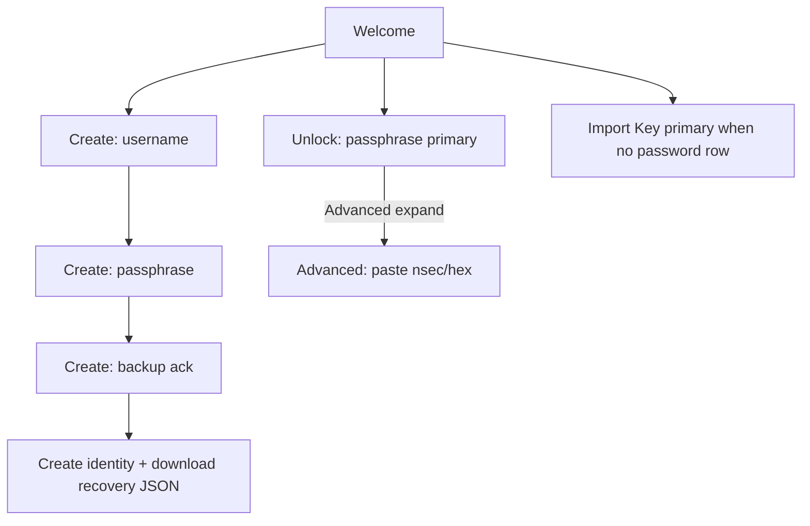

# Design — Auth wallet-grade unlock (two-secret UX)

**Date (UTC):** 2026-11-01  
**Status:** Implemented (L1/L2) · L3 soak optional  
**Investigation:** [auth-wallet-unlock-investigation-2026-11.md](./auth-wallet-unlock-investigation-2026-11.md)

```text
HANDOFF ATOMIC STEP: AUTH WALLET UNLOCK — demote hex + create backup gate
PAUSED / CANCELLED: Soft L3 · Tor Verified · Spaces · Matrix promote · OAuth · adapter auth
NOTE: keychain silent restore **allowed for PDK only** (Slice C 2026-11) — not identity silent unlock without consent
CANONICAL OWNER:     AuthScreen + identity-persistence recovery download helper
PROOF BEFORE DONE:   L1 helper unit · L2 auth-screen.test.tsx routing + create backup
SURFACE:             Tauri + browser AuthScreen
```

## Decision

Keep **Nostr keypair as cryptographic root**. Daily face = **device passphrase**. Hex/`nsec` = **Advanced recovery** only when a password-protected identity exists on device. Create flow adds **step 3 backup acknowledgment** and downloads the encrypted identity record JSON immediately after successful create.

## Happy paths



1. **Create** — passphrase only in primary UI; key never displayed. Step 3 requires backup acknowledgment; on submit: create → download `obscur-identity-recovery-*.json` (encryptedPrivateKey + publicKeyHex + username) → toast.
2. **Returning unlock** — if `hasPasswordProtectedUnlockOnDevice` → force Log In (passphrase); Import Key behind Advanced disclosure (no peer tab chrome).
3. **New device / no password row** — Import Key (or Restore backup) remains primary (unchanged portable path).

## UI subtraction contract

| Condition | Primary surface | Advanced |
|-----------|-----------------|----------|
| `devicePasswordUnlockSaved === true` | Passphrase form only | Collapsed “Unlock with private key” |
| `devicePasswordUnlockSaved === false` or null with no stored password path | Existing Import Key / Log In tabs (browser still may default Import Key) | n/a |
| Native + stored identity before probe settles | Prefer username tab | — |
| After probe true | Always username; clear peer tabs | Advanced key |

## Backup contract (create)

- **Artifact:** JSON download of on-device `IdentityRecord` (already Argon2id-wrapped ciphertext — not plaintext key).
- **Gate:** Create step 3 checkbox `backupAcknowledged` must be true before submit; submit triggers create then download.
- **Honesty:** Copy states this file unlocks only with the master password; Obscur cannot reset it; keep offline / password manager.
- **Not in this slice:** full encrypted account-sync backup publish; mnemonic seed; biometrics.

## Invariants

- No plaintext private key in localStorage / recovery JSON.
- No OAuth roots.
- Unlock still goes through Auth Kernel ports (`createIdentityForBoundProfile`, `unlockBoundProfileWithPassphrase`, `importIdentityForBoundProfile`).
- Keychain PDK restore after identity unlock: **allowed** (Slice C). Identity cold silent unlock remains deferred / consent-gated.

## Proof plan

| Layer | Command / check |
|-------|-----------------|
| L1 | Unit: `downloadIdentityRecoveryFile` builds safe JSON + triggers blob download (mock URL/createObjectURL) |
| L2 | `pnpm -C apps/pwa exec vitest run app/features/auth/components/auth-screen.test.tsx` — passphrase-primary when probe true; Advanced reveals nsec; create step 3 requires ack; create downloads recovery |
| L3 | Manual desktop: create → file downloads → lock → unlock with passphrase only (not gate for this PR) |

## Impl file touch list

- `apps/pwa/app/features/auth/utils/download-identity-recovery-file.ts` (+ test)
- `apps/pwa/app/features/auth/components/auth-screen.tsx`
- `apps/pwa/app/features/auth/components/auth-screen.test.tsx`
- i18n keys in `apps/pwa/app/lib/i18n/locales/en.json` (and mirror if required by docs:check — prefer en + existing pattern)

## Explicitly later

- Adapter authentication facade  
- OS biometric gate over vault  
- Mandatory mnemonic  
- GIF refresh for unlock story  

_Last updated: 2026-11-01T09:35:00Z_
