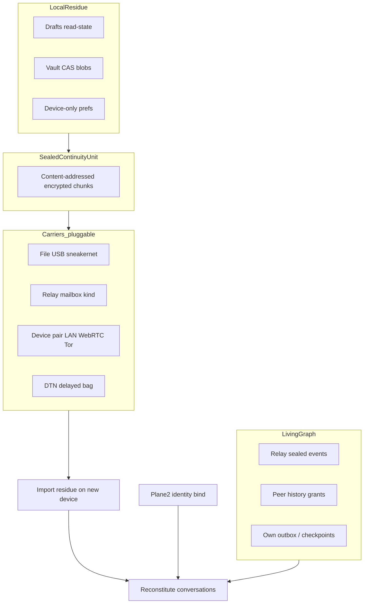

# Design exploration — Pioneering continuity (beyond file vs relay)

**Date:** 2026-11-01  
**Status:** Exploration — not an impl band; does not block single-door A+B  
**Parents:** [auth-continuity-audience-deliberation-2026-11.md](./auth-continuity-audience-deliberation-2026-11.md) · [single-door-unlock-design-2026-11.md](./single-door-unlock-design-2026-11.md)  
**As-built:** encrypted backup kind `30078` · `unified-account-export-service` · native SQLite bodies · DTN/sneakernet dialect (charter priority 4) · vault CAS

```text
HANDOFF ATOMIC STEP: PLANE-3 PIONEERING CONTINUITY — design exploration only
PAUSED / CANCELLED: Soft L3 · Tor · Spaces · Matrix promote · OAuth · unlock impl without A+B approve
CANONICAL OWNER:     Continuity / account-sync (+ transport carriers)
PROOF BEFORE DONE:   Spec accepted or parked — no runtime claim
```

## The false binary

Two “straightforward” approaches are usually pitched as alternatives:

| Approach | User metaphor | Strength | Failure for Obscur |
|----------|---------------|----------|--------------------|
| **A. Local sealed file** | Game save / USB stick | Offline, inspectable, no server trust | Friction; easy to lose; not continuous |
| **B. Online relay “sync”** | WhatsApp/iCloud multi-device | Invisible continuity | Encourages server-shaped mental model; Obscur’s kind-30078 backup is ciphertext but still *one blob on a bus*; native bodies today are sparse |

Obscur already has **both** as incomplete as-builts (portable export + encrypted account backup). Shipping “let the user pick A or B” is honest product packaging — it is **not** pioneering. It freezes the mistake that Continuity = “move my database.”

---

## Pioneering thesis

> **Continuity is reconstitution of a living relationship graph, not replication of a device disk.**  
> Sealed packs carry only **local residue**. Network-visible sealed evidence and **peer-granted history** reconstitute the rest. Carriers for packs are fungible.



Three ingredients — one product story (“Restore / continue on this computer”), many transports.

---

## Ingredient 1 — Living-graph reconstitution (default path)

**Claim:** Much of what users call “my chat history” already exists as **ciphertext the identity can decrypt** on relays, plus membership/ledger evidence, plus peer devices.

| Source | Role |
|--------|------|
| Relay event replay / hydrate | DM and group events previously published |
| Account projection / checkpoints | Sync cursors, seals, tombstones |
| Peer history grant (new) | Counterparty (or co-member steward policy) may **offer** a sealed history slice the new device requests — voluntary, auditable, no vendor cloud |

**Pioneer vs mainstream:** Mainstream syncs a server-side plaintext or server-held envelope tied to an account. Obscur treats the **network + peers** as the durable store for anything that was allowed to leave the device. New laptop ≠ download-from-iCloud; it is **rejoin the graph as this pubkey**.

**Honesty:** Local-only messages never published cannot appear via living graph. That gap is Ingredient 2 — not a reason to pretend full cloud mirror.

**Fits audiences:** Technical + Web3 expect this; non-tech needs copy: “Messages you sent through the network can return; drafts and offline-only items need a Continuity pack or another of your devices.”

---

## Ingredient 2 — Sealed Continuity Unit (SCU) for local residue only

**SCU** = versioned, compressed, **passphrase-wrapped** (same device password / recovery secret), **content-addressed chunk** set.

| In SCU | Out of SCU (prefer living graph) |
|--------|----------------------------------|
| Drafts, unread markers, device prefs | Already-published DM/group ciphertext |
| Vault CAS blobs not on relays | Membership that can be re-proven from ledger/coordination |
| Native SQLite bodies **not** yet in backup publish (today’s BKP-2 gap) until living path covers them | Identity root (Plane 2 recovery file / key — separate artifact) |

**Why not “full DB dump as the product”:** Full-disk save files teach users Continuity = A. SCU is deliberately **narrow** so the pioneering path stays graph-first.

**BKP-2 relationship:** Fixing backup publish to include SQLite bodies improves **relay-carrier SCU / kind-30078**, not a third philosophy. Kind-30078 becomes **one carrier serialization of SCU chunks**, not “the sync product.”

---

## Ingredient 3 — Fungible carriers (A and B collapse)

User does not choose “file sync product” vs “online sync product.” They choose **how to move the same SCU**:

| Carrier | Maps to today’s intuition | Obscur dialect |
|---------|---------------------------|----------------|
| File / USB / AirDrop | Game save | Portable export evolved → SCU bundle |
| Relay mailbox | Mainstream multi-device | Kind-30078 (or chunked successors) as **transport**, ciphertext opaque to operator |
| Device pairing | Rare in chat apps; common in password managers | Short-lived encrypted channel (LAN / WebRTC / Tor) after QR or code; push missing SCU chunks + optional live session handoff |
| DTN / sneakernet bag | Air-gap | Charter dialect priority 4 — same SCU bytes, delayed delivery |

**Pioneer UX sentence:** “Save a Continuity pack” and “Publish Continuity to my relay” and “Send Continuity to my other computer” are **three buttons on one object**, not two architectures.

```text
Same SCU bytes
  → write file
  → publish mailbox event(s)
  → stream over pair session
  → drop in DTN bag
```

---

## Ingredient 4 — Device pairing as first-class (the missing third button)

Neither USB nor “always-on relay account sync” covers the common case: **phone and desktop both online for five minutes**.

**Pairing flow (design sketch):**

1. Device A unlocked (Plane 1). Device B completes Plane 2 (recovery file or key → device password bind).
2. A shows QR / short code; B confirms pubkey fingerprint.
3. Ephemeral session key; A advertises SCU chunk inventory (hashes only); B requests missing chunks + optionally “live catch-up.”
4. Session ends; no standing cloud sync subscription required.

**Enterprise cell:** IT can require “pair only on corp LAN” via operator policy later — still no SSO-as-root.

**Web3:** Pairing is between devices of the **same pubkey**, not a wallet connect theater.

---

## Ingredient 5 — Peer history grants (social continuity)

Optional, high-trust, pioneering for E2EE messengers that usually say “history never moves.”

| Grant | Who | What |
|-------|-----|------|
| DM counterparty offer | Other person in 1:1 | Sealed export of messages they still hold, encrypted to requester’s pubkey |
| Group steward policy | Deploy-time | Whether members may request sealed backfill after rejoin |
| Refuse | Default | No grant → living graph + own SCU only |

Prevents “server holds everyone’s history” while allowing human-scale recovery when the user’s only device dies without an SCU.

**Non-goal:** forced social recovery of the **identity key** (separate threat); this is history residue, not key custody.

---

## Continuity states (aligned with audience deliberation)

| State | How it is reached |
|-------|-------------------|
| `empty` | Plane 2 done; no replay/SCU/pair/grant yet |
| `replaying` | Living-graph hydrate in progress |
| `restored_partial` | Some SCUs / grants / sparse backup applied; gaps named |
| `restored_full` | Inventory proves residue + graph catch-up complete (strict bar) |

UI names the **plane and ingredient**, never “syncing with cloud.”

---

## What we reject as “pioneering”

| Idea | Why not |
|------|---------|
| Transparent multi-device like Slack with operator-readable store | Violates client encryption + anti-extraction |
| OAuth-gated sync vault | Forbidden as identity/continuity root |
| Single always-on relay mirror of full SQLite as the *only* story | Re-creates approach B as religion; fails air-gap and sparse-publish truth |
| Dual product modes “Offline sync” vs “Online sync” as separate stacks | Two owners, two bugs; carriers must share SCU schema |
| Deriving vault PDK from nsec to “simplify” | Rejected in single-door; breaks existing envelopes |

---

## Phased path (does not reorder unlock)

| Phase | Work | Depends |
|-------|------|---------|
| **P0** | Single-door Planes 1–2 (A+B+C) | Maintainer approve |
| **P1** | Continuity honesty UI + state enum | Audience deliberation accepted |
| **P2** | SCU schema + file carrier (evolve portable export) | P1 |
| **P3** | Relay mailbox = SCU chunks (subsume/fix kind-30078 + BKP-2 bodies) | P2 |
| **P4** | Device pairing carrier | P2 |
| **P5** | Peer history grants | P1 + policy |
| **P6** | DTN bag carrier | P2 + RUST-6 |

Pioneering **design** can be accepted now; **impl** stays behind P0 unlock. Do not start P2–P6 while dual-door unlock still blocks chat.

---

## Audience fit (one line each)

| Audience | How pioneering reads |
|----------|----------------------|
| Non-tech | “Continue on this computer” → password; history “comes back from the network”; optional “transfer pack” or “link my other device.” |
| Technical | Explicit inventory: graph vs residue vs carrier; fail-closed gaps. |
| Web3 | Pubkey rejoins relays; pairing/grants are crypto-native; no wallet onboarding theater. |
| Enterprise | Operator runs relays + recovery runbook; pairing policy; no admin plaintext; SSO still badge-only later. |

---

## Maintainer decision (when ready)

1. Accept or park this **Living graph + SCU + fungible carriers + pairing + grants** thesis as Plane 3 north star.  
2. Keep “user picks file vs relay” only as **carrier UX**, not as architecture fork.  
3. Do **not** let this delay single-door A+B.

_Last updated: 2026-11-01T16:40:00Z_
