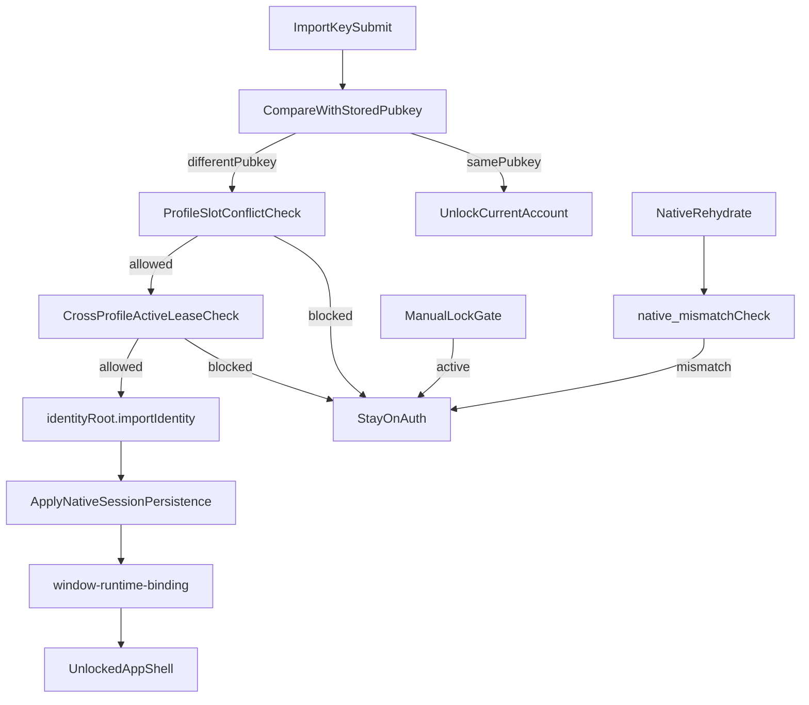

# Obscur System Logic Audit — 2026-08

**Status:** Audit only  
**Band:** Critical regression study  
**Scope:** Auth import/unlock, multi-profile isolation, contact/search/request state ownership  
**Constraint:** `AUTH-SESSION` remains forbidden by current handoff; this document does **not** authorize direct auth/session implementation.

---

## Executive Summary

Obscur is currently failing as a **system of competing owners**, not as a set of isolated bugs.

Two failure clusters dominate:

1. **Second-account import / auth rebound**
   - `Import Key` is not a single-path "log in new account" action.
   - It conditionally becomes:
     - unlock current account,
     - slot-conflict surface,
     - active-session lease conflict,
     - native restore mismatch,
     - manual-lock gated auth_required reset.
   - The user-visible result is "enter key -> no useful state transition -> still on Auth".

2. **Contact/search/request state divergence**
   - `contactsByPeer` is emerging as the canonical account projection owner.
   - `peerTrust`, `requestsInbox`, `requestFlowEvidence`, and legacy `connectionStore` still coexist.
   - Different surfaces read different layers, so "remove", "search", "message", and "voice call" can disagree.

This is a classic dual-write / multi-read consistency failure.

---

## Handoff Constraints

- `docs/handoffs/current-session.md` currently says:
  - `PAUSED — dialect research`
  - allowed: study docs / demo polish / critical regression fixes only
  - forbidden: `AUTH-SESSION`
- Therefore:
  - this audit can identify owner conflicts and safe containment slices
  - direct repair of auth/session core requires a separate maintainer charter

---

## Symptom Register

### A. Private key import for second account appears to do nothing

Observed behavior:
- user enters private key on Auth screen
- continues through Import Key flow
- shell does not unlock into the second account
- UI remains on or returns to Auth

### B. Remove contact is not logically final

Observed behavior:
- remove contact executes
- re-searching the same peer still surfaces high-trust actions or profile state inconsistent with a fresh request flow

### C. Search / profile / chat surfaces disagree

Observed behavior:
- one surface implies "trusted contact"
- another implies "pending request"
- another allows or blocks message / voice differently

---

## Audit Method

This audit used MCP codegraph exploration plus direct file reads to reconstruct owner flows across:

- auth entry and runtime unlock
- desktop native session restore
- account projection reducers/selectors
- peer trust and request inbox read arbitration
- legacy contact / invite storage

---

## Cluster 1: Auth Import / Second Account Failure

### 1.1 Import Key is a branching action, not a single "new login" path

`AuthScreen` computes the imported public key and compares it with the currently stored identity. If the pubkey matches the bound profile's stored account, it runs **unlock current account**. Only a different pubkey enters the import path.

Relevant owner:
- `apps/pwa/app/features/auth/components/auth-screen.tsx`

Behavior summary:
- same pubkey -> `runtime.unlockBoundProfileWithPrivateKeyHex(...)`
- different pubkey -> `runImportKeyLogin(...)`
- before that, possible slot-conflict interception

### 1.2 Slot conflict can block import before identity import even starts

If the current bound profile already has a stored identity and the imported pubkey differs, `surfaceIncomingImportKeySlotConflict(...)` may stop the flow.

Implication:
- user may perceive "Continue did nothing"
- system believes it protected a bound profile slot

### 1.3 Cross-profile active session lease can block second-account activation

`runAuthKernelBoundProfileImport(...)` calls `assertAccountUnlockAllowedAsync(...)` before import.

Relevant owner:
- `apps/pwa/app/features/auth-kernel/auth-kernel-bound-profile-auth.ts`
- cross-profile lease layer beneath it

If the account is already active in another profile/window:
- import path halts
- Auth UI remains
- conflict state is surfaced instead of unlocking

### 1.4 Native keychain restore may rehydrate another account

Native session restore can scan other profiles and rebind under non-strict behavior.

Relevant owner:
- `apps/desktop/src-tauri/src/commands/session.rs`

This creates a major mismatch class:
- JS expects account A for the current profile
- native restore may produce account B
- JS then classifies this as `native_mismatch`
- shell remains locked

### 1.5 Manual lock is now a dual gate across JS and Rust

Unlocking the app shell requires:
- identity status = unlocked
- public key present
- runtime phase not fatal
- auth-kernel manual lock inactive

Relevant owners:
- `apps/pwa/app/features/runtime/services/window-runtime-binding.ts`
- `apps/pwa/app/features/runtime/services/window-runtime-contracts.ts`
- `apps/desktop/src-tauri/src/session.rs`

Either JS-side or Rust-side manual lock can keep the shell in Auth.

### 1.6 Auth failure tree

### 1.7 Auth cluster conclusion

The current auth/import system has **multiple legitimate veto points**, but they are not presented to the user as a unified state machine. The UI symptom "it just goes back to Auth" can result from:

- profile slot mismatch
- active session lease conflict
- native mismatch
- manual lock persistence
- runtime fatal/auth_required reset

This is a product and state-model issue, not merely a button bug.

---

## Cluster 2: Contacts / Search / Requests / Projection Divergence

### 2.1 `contactsByPeer` is the intended canonical owner

Projection state appears to be the target owner for relationship truth.

Relevant owners:
- `apps/pwa/app/features/account-sync/services/account-event-reducer.ts`
- `apps/pwa/app/features/account-sync/services/account-projection-selectors.ts`

Relationship status is reduced from canonical contact events:
- `CONTACT_REQUEST_SENT`
- `CONTACT_REQUEST_RECEIVED`
- `CONTACT_ACCEPTED`
- `CONTACT_DECLINED`
- `CONTACT_CANCELED`
- `CONTACT_REMOVED`

### 2.2 `peerTrust` is still a mixed projection + legacy owner

`usePeerTrust()` does not exclusively trust projection.

Relevant owners:
- `apps/pwa/app/features/network/hooks/use-peer-trust.ts`
- `apps/pwa/app/features/network/services/peer-trust-read-authority.ts`

Current read behavior:
- before projection cutover: read stored legacy trust
- if projection empty but legacy non-empty: hold legacy
- otherwise: union legacy + projection

This means accepted state can survive removal unless **all** sources converge.

### 2.3 `requestsInbox` is still dual-mode

`useRequestsInbox()` reads from:
- projection selectors when read-cutover allows it
- legacy chat-state storage otherwise

Writes also differ:
- canonical events under new mode
- legacy persistence under old mode

Result:
- remove/cancel/decline timing depends on which mode the surface is in

### 2.4 `requestFlowEvidence` can independently project acceptance-like states

`deriveRequestProjection()` treats `evidence.acceptSeen` as sufficient for accepted projection.

Relevant owner:
- `apps/pwa/app/features/messaging/services/request-status-projection.ts`

So even if inbox status is stale or removed, evidence may keep a surface in an "accepted" or non-fresh-request branch.

### 2.5 `connectionStore` remains an old parallel owner

Legacy invite/contact storage still exists via a fixed DB name:

- `apps/pwa/app/features/invites/utils/connection-store.ts`
- `apps/pwa/app/features/invites/utils/db/invite-db-name.ts`

Observed property:
- DB name is global (`obscur-invites`)
- not obviously profile-scoped

This store can keep legacy contact/address-book state alive even when projection and trust are changing.

---

## Surface Read Matrix

### Search / Discovery

Search and discovery are not a clean "fresh request only" surface.
Some paths still allow navigation into profile-level actions that depend on trust/inbox/projection outcomes outside the search result itself.

### Network Profile

`network-profile-view.tsx` computes:
- `isTrusted` from `peerTrust.state.acceptedPeers`
- `requestStatus` from `requestsInbox.getRequestStatus(...)`
- `requestProjection` from `deriveRequestProjection(...)`

Therefore this page is a **fusion surface**. It is not reading one canonical layer.

### Chat Compose

`use-chat-actions.ts` uses:
- `peerTrust.isAccepted(...)`
- `requestsInbox.getRequestStatus(...)`

It can disagree with `network-profile-view.tsx` if they read different merged results or timing windows.

### Invitations

Invitation state depends on:
- projection or stored inbox mode
- request event tombstones
- request flow evidence

This is also not a single-source-of-truth surface.

---

## Profile Isolation Audit

### 3.1 Correctly scoped systems

The following areas are largely profile-scoped:

- `getScopedStorageKey(...)` users
- request flow evidence store
- request event tombstone store
- scoped chat-state legacy storage
- account projection runtime
- profile runtime provider / desktop profile runtime

### 3.2 Incorrect or incomplete isolation

#### `peerTrust` keying

`peerTrust` localStorage key is based on `publicKeyHex`, not `profileId`.

Implications:
- same account imported into multiple profiles shares trust state
- one profile's remove/unaccept can affect another
- profile isolation is incomplete by design

#### `connectionStore`

Legacy invite DB uses a fixed global DB name.

Implications:
- contact/address-book data can leak across profiles
- old UI surfaces may read shared state

#### Memory owner transitions

Some hooks key hydration on `publicKeyHex` while runtime scope is actually `profileId + publicKeyHex`.

Implications:
- fast profile/window transitions may briefly reuse stale in-memory state

---

## Owner Conflict Matrix

| Concern | Intended owner | Parallel owner(s) still active | Failure mode |
|---|---|---|---|
| Contact accepted/removed truth | `contactsByPeer` projection | `peerTrust` localStorage | remove/trust divergence |
| Request inbox state | projection selectors | legacy chat-state request storage | stale pending/accepted badges |
| Action gating (`message`, `voice`, `connect`) | should be projection-driven | peerTrust + inbox + evidence fusion | surface disagreement |
| Contact/address-book presence | projection/contact model | legacy `connectionStore` | removed contact still looks live |
| Auth/account identity binding | bound profile runtime | native rehydrate, cross-profile lease, manual lock | import returns to Auth |

---

## Primary Root Causes

1. **Multiple relationship owners remain live at once**
2. **Projection cutover is incomplete; union/hold logic preserves stale truth**
3. **Old connection/address-book storage still participates in UI behavior**
4. **Profile isolation is inconsistent across stores**
5. **Auth import is a branching policy engine exposed as a simple login action**

---

## Immediate Audit Conclusions

### Safe to say

- The app is not failing because one reducer is wrong.
- It is failing because several layers still claim partial ownership of the same state.
- Any further "quick patch" on one surface risks worsening global inconsistency.

### Unsafe to say

- "Fix auth button"
- "Fix remove contact"
- "Fix search page"

Those labels are too shallow for the actual system failure.

---

## Required Next Artifact

The next document must be a **remediation charter**, not a patch list.

It needs to decide:

1. which owners are canonical
2. which legacy paths must be retired
3. which surfaces must be temporarily downgraded or hidden
4. which auth/session issues require a separate charter because of forbidden handoff scope

