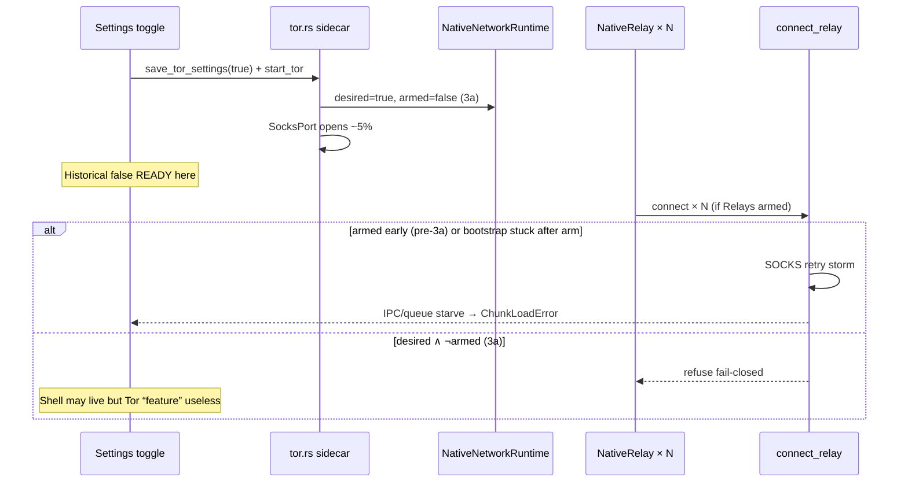

# Investigation — Tor × Rust native integration regression (codebase-wide)

**Date (UTC):** 2026-08-08  
**Status:** Investigation Ready · maintainer evidence accepted · **no Tor-OFF re-verify**  
**Parents:** [tor-local-first-redesign-2026-08.md](./tor-local-first-redesign-2026-08.md) · [tor-enable-wedge-investigation-2026-08.md](./tor-enable-wedge-investigation-2026-08.md) · [obscur-ecosystem-charter.md](../../docs/program/obscur-ecosystem-charter.md)

```text
HANDOFF ATOMIC STEP: Codebase-wide Tor integration investigation → new architecture (not stall L3)
PAUSED / CANCELLED:   Community · AUTH-SESSION-1
CANONICAL OWNER (target): TorLifecycle (single) — process + arm + dial budget
PROOF BEFORE DONE:    This investigation accepted → design for Option A/B → then impl
OUT OF SCOPE:         Tor-OFF re-soak · Thin UI · Community · AUTH-SESSION · more fail-closed micro-patches as the product
```

## Settled evidence (do not re-ask)

| Fact | Source |
|------|--------|
| Tor ON → client unresponsive / unusable | Maintainer repeated L3 (ChunkLoadError, native timeouts, SOCKS storms) |
| Tor OFF → client usable | Same sessions |
| “Remove Tor to work” = **app failure signal** | Maintainer 2026-08-08 |
| Early full-TS Obscur could operate with Tor | Maintainer historical claim — treat as goal memory |
| Post–Rust native relay/net path **regressed** Tor | Code + wedge logs |

**Agent rule:** Do **not** schedule Tor-OFF verification as a gate. Proceed to architecture.

---

## Executive diagnosis

The regression is **not** “Rust is bad.” It is that Tor was integrated as **three loosely coupled owners** on the native path, while the WebView **cannot** use system SOCKS the way early TS/browser stacks often did:

1. **Process** — `tor` sidecar (`tor.rs`)  
2. **Routing arm** — `NativeNetworkRuntime` desired vs armed (`net.rs`)  
3. **Dial fan-out** — parallel `NativeRelay` → `connect_relay` IPC (`relay.rs` + PWA pool)

Early mental model: “toggle proxy, sockets follow.”  
Current reality: fake browser WS → Tauri invoke → Rust SOCKS × N relays × retries → shared async/IPC with UI → host starves.

Fail-closed 3a (arm only at 100%, refuse while pending, retry ≤3) is **scaffolding**, not the product solution.

---

## Owner map (codebase-wide)

### A. Desktop Rust / Tauri

| Concern | File | Role | Wedge contribution |
|---------|------|------|--------------------|
| Sidecar lifecycle | `apps/desktop/src-tauri/src/commands/tor.rs` | start/stop/logs/status | Process + false-ready history |
| Settings file | `%APPDATA%/…/tor_settings.json` via `save_tor_settings` | Persist enable/proxy | Dual store vs JS |
| SOCKS arm | `apps/desktop/src-tauri/src/net.rs` | `tor_desired` / `enable_tor` (armed) | Hot path for all native WS/HTTP |
| Relay dial | `apps/desktop/src-tauri/src/relay.rs` | `connect_relay_internal` SOCKS/clearnet | Per-URL budgets × parallel callers |
| Boot | `apps/desktop/src-tauri/src/lib.rs` | Never start Tor; may set desired from file; orphan kill | Stale desired → refuse dials |
| Mesh Tor policy | `apps/desktop/src-tauri/src/mesh/tor_policy.rs` | TorRequired fail-closed | Second ready oracle |
| Mesh HTTP SOCKS | `mesh_http_fetch_via_socks` | Explicit proxyUrl | **Bypasses** arm gate |
| Media / NIP-96 / notify | `upload.rs`, `notification.rs`, `fetch_remote_bytes` | `build_reqwest_client` | Armed Tor HTTP load |
| Sidecar package | `tauri.conf.json` + `scripts/setup-tor.mjs` | Expert Bundle binary | Build lock on `tor.exe` |
| Orphan kill | `kill_orphan_tor_processes` | `taskkill /IM tor.exe` | Nuclear — kills any Tor |

### B. PWA / TypeScript

| Concern | File | Role | Wedge contribution |
|---------|------|------|--------------------|
| Tor toggle owner | `use-auto-lock.ts` | **Only** caller of save/start/stop | Starts sidecar; status fan-out |
| Tor UI | `auto-lock-settings-panel.tsx` | Labels READY from `connected`/`ready` | Trusts host snapshot |
| Dual settings | `privacy-settings-service.ts` | localStorage `enableTorProxy` | Desync vs native file |
| Native bridge | `relay-native-adapter.ts` | `get_tor_status`, `connect_relay` 20s timeout | IPC pressure |
| Fake WS | `native-relay.ts` + `create-relay-websocket.ts` | Browser API → native dial | **Primary storm** |
| Mesh pool | `use-conduit-mesh-relay-pool.ts` / `conduit-mesh-nostr-ws-client.ts` | Parallel sockets | N concurrent connects |
| FullRelay | `relay-provider.tsx` | Pool URLs, `privacy_routed` on **configured** | Tor-shaped recovery while pending |
| Dial hold | `local-first-runtime-policy.ts` | Relays arm (session) | Orthogonal to Tor; mitigates only if held |
| Mesh Tor port | `conduit-mesh-tor-host-port.ts` | `getTorStatus` on `tor-status` | Extra invokes |
| SOCKS HTTP port | `conduit-mesh-socks-fetch-port.ts` | C13 fetch | Independent of arm |
| Pack Apply | `transport-preset-apply-policy.ts` / relays model | Tor pack gate on `ready` | Second dial wave if Apply |
| Packages | `obscur-conduit-mesh*` | Policy / map ready | Passthrough of host lie |

### C. Explicit non-owners (noise)

| Surface | Note |
|---------|------|
| Account-sync | No Tor API — rides relay pool only |
| Community / `localhost:7000` | PAUSED; connection refused ≠ Tor owner |
| `packages/libobscur` SOCKS scaffold | Not product dial path |

---

## Coupling bugs (ranked)

| # | Bug | Why it wedges |
|---|-----|----------------|
| 1 | **WebView cannot use system SOCKS** — product uses NativeRelay IPC | Every dial is a native command on the UI-critical runtime |
| 2 | **Parallel N public relays** × per-URL SOCKS retry | Historical 36×; still uncapped concurrency after 3a |
| 3 | **False ready** (TCP / Connected) historically armed routing early | Relays hit dead proxy; UI claimed READY at 5% |
| 4 | **`privacy_routed` from `configured` not circuit-ready** | Recovery/retry policy becomes Tor-shaped while bootstrap fails |
| 5 | **Dual settings** (localStorage + `tor_settings.json`) | Intent vs process vs arm disagree |
| 6 | **`mesh_http_fetch_via_socks` ignores arm** | Parallel SOCKS owner |
| 7 | **`tor-status` → re-`get_tor_status` fan-out** | Amplifies native load during bootstrap chatter |
| 8 | **Nuclear orphan kill** | Collateral + build/runtime fights over `tor.exe` |
| 9 | **Dial hold ⊥ Tor enable** | User can arm Relays then enable Tor → storm; or desired without arm → mass refuse |
| 10 | **Probe clearnet under Tor desired** | Leak + extra load |

---

## Sequence (current wedge shape)



---

## Why early TS felt better (hypothesis → design constraints)

| Early TS-shaped stack | Constraint for redesign |
|-----------------------|-------------------------|
| Fewer parallel native IPC dials | Cap global Tor dial concurrency at 1–2 |
| Proxy closer to one networking client | One TorLifecycle; one dial scheduler |
| Failure stayed in network layer | Tor must never share unlock-critical command queue without budget |
| Toggle ≈ use proxy | Arm gate + Relays arm + Tor Apply must be explicit and ordered |

---

## Architecture options (new solution — choose one)

### Option A — **Tor transport mode** (recommended)

**Idea:** Tor is not a global SOCKS switch for the entire native net stack. It is a **transport mode** entered only after:

1. Shell local-first stable  
2. User enables Tor → sidecar reaches **Bootstrapped 100%** (only ready signal)  
3. User applies **Tor transport** (or “Route relays via Tor”) — separate from Relays clearnet arm  

**Subtract:** Immediate `NativeNetworkRuntime` arm on Settings toggle; parallel `connect_relay` SOCKS from FullRelay while Tor “merely enabled.”  
**Add:** Single Rust `TorDialScheduler` (max 1–2 concurrent); TS calls `dial_pool` / mesh API instead of N× fake WS connect.  
**Exit:** Tor ON usable for DM path without ChunkLoadError; Tor OFF unchanged.

### Option B — **Isolated Tor worker process**

**Idea:** Move SOCKS dials + sidecar supervision to a **dedicated OS process** (or thread pool with hard isolation) so WebView/Tauri UI IPC never waits on Tor bootstrap failures.  
**Heavier** ops cost; stronger isolation. Use if A still starves after scheduler.

### Option C — **Browser/OS Tor only (reject for desktop product)**

Rely on system Tor / Tor Browser proxy for WebView. **Infeasible** for Tauri product WS path (NativeRelay required). Document as rejected.

### Option D — **Permanent Tor excision (reject without CANCELLED)**

Contradicts maintainer goal preservation. Forbidden unless explicit CANCELLED + feasibility doc.

---

## Recommended path (post-accept)

| Step | Deliverable | Code? |
|------|-------------|-------|
| 0 | This investigation accepted | Docs |
| 1 | Design `tor-transport-mode-design-2026-08.md` (Option A) — state machine, APIs, subtraction list | Docs |
| 2 | Impl: `TorLifecycle` + global dial scheduler; subtract N× SOCKS `connect_relay` storm | Yes |
| 3 | Gate mesh HTTP SOCKS + pack Apply on same lifecycle | Yes |
| 4 | Single settings store; scoped PID kill | Yes |
| 5 | L3: Tor ON opt-in usable (not Tor-OFF re-verify) | Runtime |

**Success criterion:** App works **with Tor when chosen** — not “works only after removing Tor.”

---

## Subtraction checklist (for design/impl)

1. One `TorLifecycle` state machine — delete parallel ready oracles  
2. Global Tor dial budget (concurrency 1–2) — subtract parallel NativeRelay SOCKS fan-out  
3. Settings enable ≠ route traffic — explicit Tor transport Apply  
4. Subtract dual localStorage/native intent drift  
5. Gate `mesh_http_fetch_via_socks` on lifecycle  
6. Scoped kill (sidecar PID), not all `tor.exe`  
7. `privacy_routed` only when armed + Connected  
8. Cap/remove clearnet probe under Tor desired  

---

## Claim language

| May say | When |
|---------|------|
| Investigation Ready | This file |
| Design Ready | Option A design file accepted |
| Tor transport Implemented | Scheduler + lifecycle landed; L1 |
| Tor opt-in Verified | L3 Tor **ON** usable |
| App Fixed | Not used until Tor opt-in Verified |

**Forbidden:** Demanding Tor-OFF re-verification as progress.
